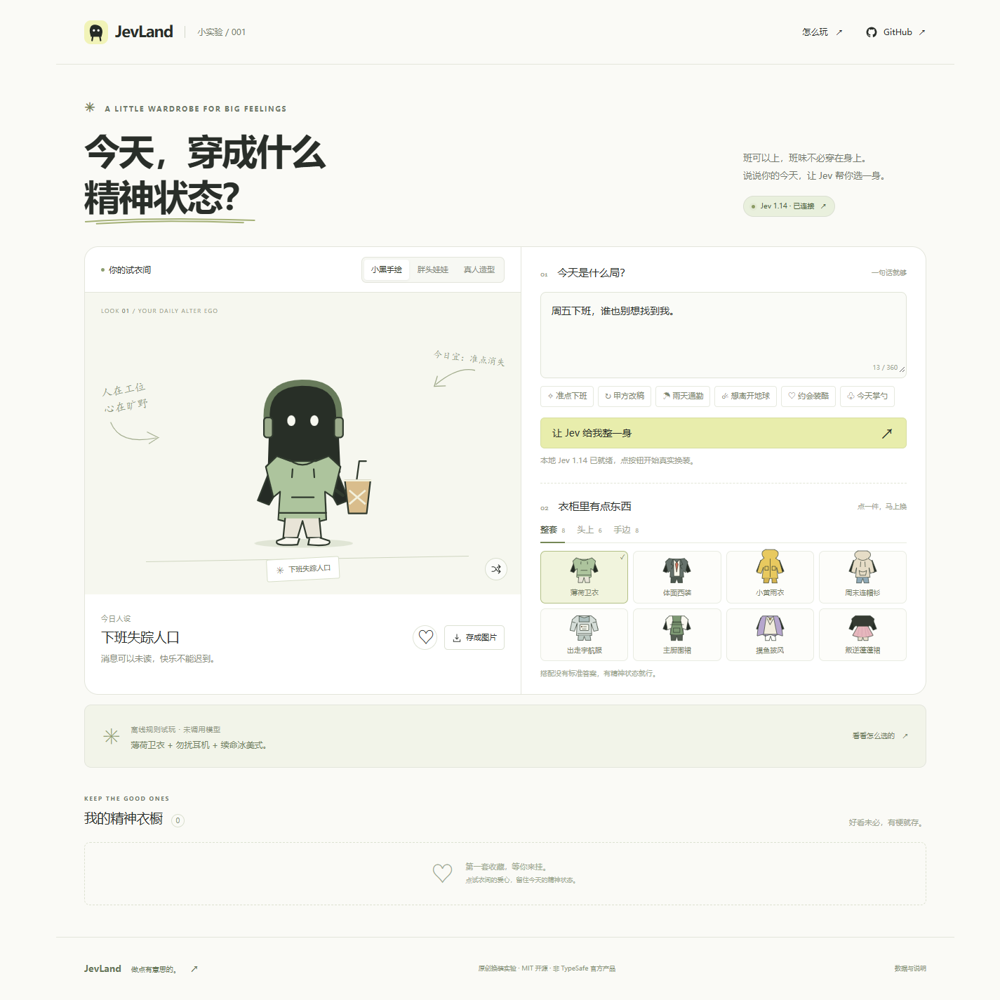

# 班味换装间 · Jev Dressroom

**今天，穿成什么精神状态？**

一句话描述今天的场景，让 Jev 1.14 从衣柜里挑出整套、头饰和道具。切换小黑手绘、胖头娃娃、真人造型，把精神状态穿出来。

[在线试玩](https://finderchangchang.github.io/jev-dressroom/) · [JevLand 中文社区](https://jevland.com/) · [模型文档](https://docs.typesafe.ai/models)



## 玩什么

- 3 种画风：原创小黑线稿、胖头角色、AI 真人造型。
- 8 套衣服、6 个头饰、8 件道具；两种手绘支持自由组合。
- 场景预设、任意文本输入、随机搭配。
- 最多收藏 12 套，保存在当前浏览器；导出 960 × 1200 PNG。
- 无 Key 可以离线试玩。连接 TypeSafe 后显示真实返回的概率、置信度和耗时。
- 白色和淡黄绿色界面，支持手机、键盘操作和减少动态效果偏好。

## 本地运行

需要 Node.js 20+。**没有第三方运行依赖，无需 npm install。**

```sh
git clone https://github.com/Finderchangchang/jev-dressroom.git
cd jev-dressroom
npm start
```

打开 `http://127.0.0.1:8894`。

真实 Jev 调用：在服务端设置 `TYPESAFE_API_KEY` 后重新启动。密钥只由本地后端读取，不会发到浏览器。

```powershell
# Windows：已在用户环境变量里设置 Key 时
$env:TYPESAFE_API_KEY = [Environment]::GetEnvironmentVariable('TYPESAFE_API_KEY', 'User')
npm start
```

也可以在本地页面的连接按钮里输入自己的 TypeSafe Key。此方式仅存在页面内存，经本机服务发送到 `https://api.typesafe.ai/v1/systemone`；刷新清除，不存入 localStorage。公开静态页不收取 Key，并提供本地运行指引。

## Jev 做了什么

程序固定调用 **`jev-1.14.0`**。截至 2026-10-16，官方文档列出它为最新版本；`jev-latest` 仍指向 `jev-1.13.0`，因此不使用这个别名。

一条请求包含三道 Choice：

```text
场景描述 → Jev 1.14 → { outfit, head, prop } → 本地绘制 / 预制造型
```

`src/wardrobe.mjs` 包含选项和英文判定说明。模型只能选择衣柜内的 ID；非法选项或不完整的概率分布会被拒绝。界面显示模型实际返回的版本和概率，不虚构延迟、准确率或费用。

**离线模式**使用本地关键词规则，不调用模型、不显示模型概率。**手动/随机模式**由用户操作产生。真实接口失败后保留原来的一身，不悄悄回退成假 AI 结果。

## 真人模式的边界

真人是原创 AI 生成的虚构成年人物。8 套造型是预制图片，按整套衣服切换；不是上传自拍、实时换脸、视频或逐件虚拟试穿。单独选择的头饰和道具会保留，并能在两种手绘风格中看到。真人图里的道具属于该预制造型。

Jev **没有**生成真人图片和台词；台词由本项目预先编写，图片由独立图像生成工具制作。当前使用文本 Choice，未使用仍处于实验阶段的图像/Box 接口。

## 数据和部署

- 收藏只保存三个衣柜 ID 和画风，不保存 Key 或场景文本。
- 本地服务默认只监听 `127.0.0.1`，拒绝跨站写入；每个地址每分钟最多 20 次调用。
- 静态在线版本无需后端，提供离线试玩及本地安装指引。真实调用在本地版使用自己的 Key，在线站不提供公共共享 Key。
- 不要把 `.env`、Key 或私有资料放进公开仓库。不要把开发服务直接当作公网多用户 API。
- GitHub Pages 可从 `main` 分支根目录发布。没有构建步骤，`.nojekyll` 已包含。

```sh
npm run check
npm test
```

## 项目结构

```text
index.html             页面
src/styles.css         浅色布局和响应式
src/wardrobe.mjs        衣柜、请求构造和响应校验
src/portrait.mjs        两种原创 SVG 角色和衣物
src/app.js             交互、收藏、导出和直连
server.mjs             无依赖本地服务与安全代理
assets/real-looks.png   8 格真人造型素材
docs/                  参考来源与素材说明
tests/                 请求边界、响应校验与服务器检查
```

## 参考与原创

参考“说场景 → 选择衣服 → 展示造型”的产品模式。我们做了自己的三画风角色、职场幽默、画面布局和实现，没有复制参考视频、人物素材或参考项目代码。相关项目及准确边界见 [参考记录](docs/references.md)，素材生成说明见 [素材说明](docs/assets.md)。

MIT License。JevLand 为独立中文社区，本项目与 TypeSafe 无隶属关系。

---

**English:** A light, playful dress-up lab with three visual styles. Jev 1.14 selects an outfit, headwear and a prop in one typed-decision call. Two original SVG characters support combinatorial dressing; the photo mode uses eight pre-generated fictional-person looks. The public static site is an offline playground. Run locally with a server-side key or an in-memory bring-your-own key for live decisions. Node 20+, no dependencies. `npm start` and open port 8894.
